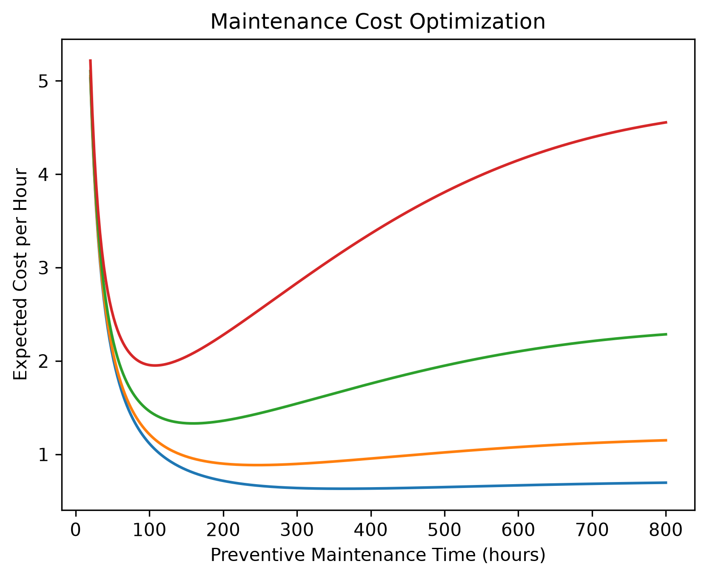
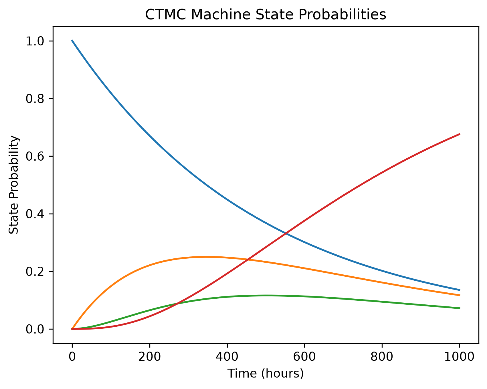
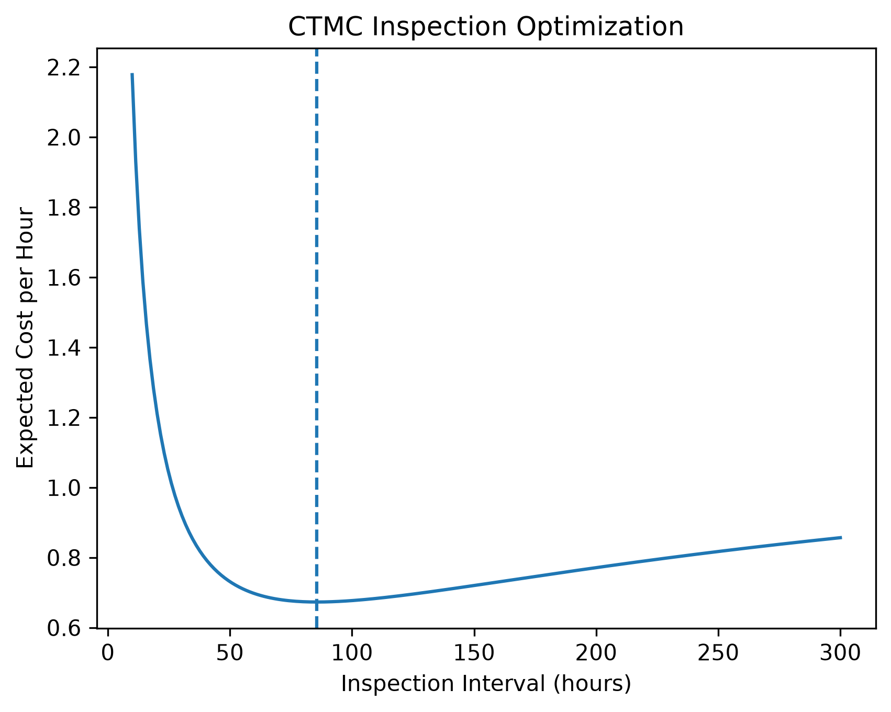
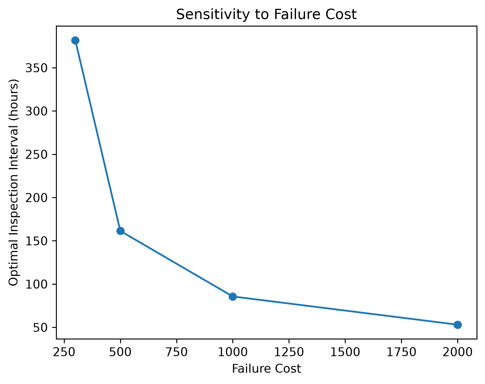
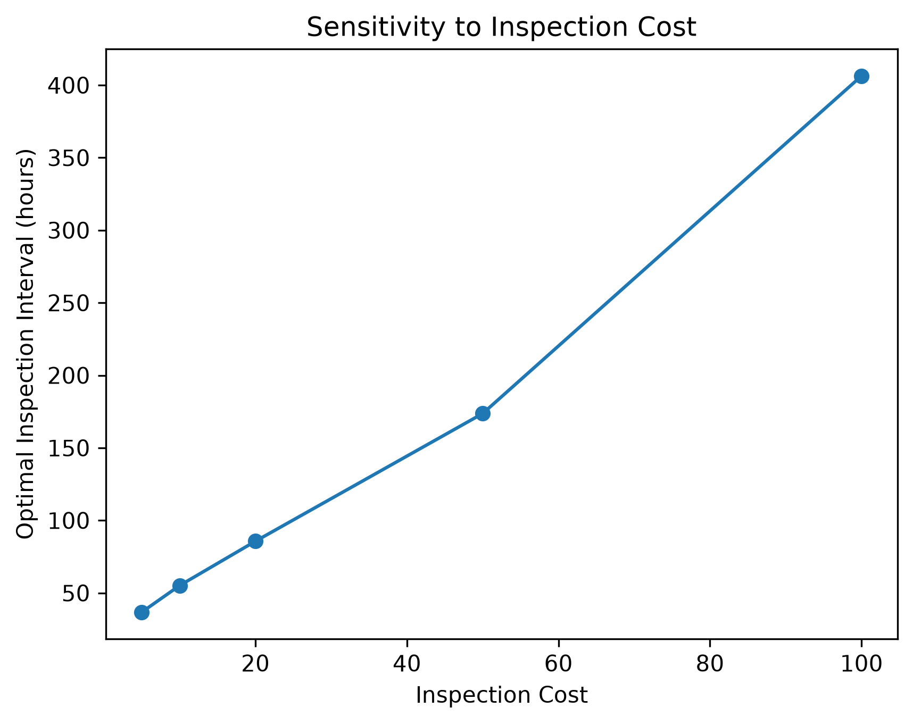
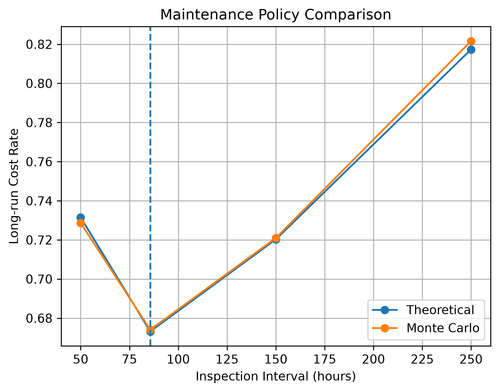

# Machine Reliability and Maintenance Optimization

## Overview

This project develops a reliability and maintenance optimization framework for a degrading machine system.

The project combines:

* Weibull reliability analysis
* Preventive maintenance optimization
* Continuous-Time Markov Chain (CTMC) modeling
* Inspection policy optimization
* Sensitivity analysis
* Monte Carlo simulation

The main goal is to answer the following question:

> **How often should a machine be inspected or maintained in order to minimize long-run expected cost under stochastic degradation?**

The project starts from a simple age-based reliability model and gradually extends it to a state-based CTMC maintenance model.

---

## Project Flow

```text
Failure Data
    ↓
Weibull Reliability Model
    ↓
Age-Based Maintenance Optimization
    ↓
CTMC Degradation Model
    ↓
Inspection Policy Optimization
    ↓
Sensitivity Analysis
    ↓
Monte Carlo Validation
```

---

## 1. Weibull Reliability Analysis

Machine lifetime is modeled using a Weibull distribution.

The estimated parameters are:

```text
Shape parameter β = 1.9267
Scale parameter η = 474.2850 hours
```

Because:

```text
β > 1
```

the hazard rate increases with operating time, indicating an aging or wear-out process.

The reliability function is:

```text
R(t) = exp(-(t / η)^β)
```

and the hazard rate is:

```text
h(t) = (β / η) × (t / η)^(β - 1)
```

The model provides the basic failure behavior used in the maintenance optimization stage.

---

## 2. Age-Based Preventive Maintenance Optimization

The first maintenance model considers an age-based preventive replacement policy. The machine is preventively replaced at a fixed operating time `T`, unless failure occurs earlier.

The model evaluates the trade-off between replacing the machine too early and allowing it to operate too long.

The long-run expected cost rate is defined as:

```text id="a1"
C(T) =
[ C_p R(T) + C_f (1 - R(T)) ]
/
[ ∫_0^T R(t) dt ]
```

where:

```text id="a2"
C_p = preventive maintenance cost
C_f = corrective maintenance cost
R(t) = reliability function
```

The denominator represents the expected length of one replacement cycle:

```text id="a3"
E[min(X, T)] = ∫_0^T R(t) dt
```

The optimization problem is therefore:

```text id="a4"
T* = arg min C(T)
         T > 0
```

Using the estimated Weibull parameters and the following cost assumptions:

```text id="a5"
Preventive maintenance cost = 100
Failure cost = 1000
```

the optimized result is:

```text id="a6"
Optimal preventive maintenance time = 159.43 hours
Minimum expected cost rate = 1.3312 per hour
```

### Maintenance Cost Optimization



The result shows that the maintenance decision can be formulated as a continuous optimization problem rather than selecting a replacement interval heuristically.


## 3. CTMC Degradation Model

The age-based model assumes that machine condition is determined mainly by operating time.

To represent stochastic degradation more realistically, the system is extended to a Continuous-Time Markov Chain.

The machine can occupy four states:

```text
Healthy
   ↓
Degraded
   ↓
Critical
   ↓
Failed
```

The transition rates used in the current model are:

```text
λ01 = 0.002
λ12 = 0.004
λ23 = 0.008
```

The CTMC generator matrix is:

```text
Q =
[ -λ01   λ01      0       0   ]
[   0   -λ12    λ12       0   ]
[   0     0    -λ23     λ23  ]
[   0     0      0        0   ]
```

The transition probability matrix is calculated using:

```text
P(t) = exp(Qt)
```

Unlike the age-based model, machines with the same operating age can occupy different degradation states.

This makes condition inspection meaningful.

### State Probabilities



---

## Intermediate Inspection Prototype

Before introducing the CTMC model, an intermediate inspection model was developed using an age-dependent Weibull hazard threshold to represent degradation.

The optimization result showed that the optimal inspection interval became almost identical to the replacement interval. This indicated that inspection provided little additional value when degradation was determined only by machine age.

This observation motivated the transition to a stochastic CTMC degradation model, where machines with the same operating age may occupy different condition states and inspection can therefore provide meaningful information.

## 4. CTMC Inspection and Maintenance Policy

The CTMC model is used to evaluate a condition-based inspection policy under stochastic degradation.

The machine is inspected every `T` hours. At each inspection, the maintenance action depends on the observed state:

```text id="b1"
Healthy   → Continue operation
Degraded  → Continue operation
Critical  → Preventive replacement
Failed    → Corrective replacement
```

Because degradation is stochastic, machines with the same operating age may occupy different states. Therefore, inspection provides additional information that cannot be obtained from age alone.

For a given inspection interval `T`, the transient-state probabilities evolve according to:

```text id="b2"
p(t) = p(0) exp(Qt)
```

where `Q` is the CTMC generator matrix.

The long-run expected maintenance cost rate is defined as:

```text id="b3"
J(T) =
Expected cost per maintenance cycle
/
Expected cycle length
```

The expected cycle cost includes:

```text id="b4"
inspection cost
+ preventive replacement cost
+ corrective failure cost
```

The optimization problem is:

```text id="b5"
T* = arg min J(T)
         T > 0
```

This formulation captures the main trade-off of the inspection policy:

```text id="b6"
Short inspection interval
→ higher inspection cost
→ lower risk of undetected critical degradation

Long inspection interval
→ lower inspection cost
→ higher failure risk
```

Under the current model parameters:

```text id="b7"
Inspection cost = 20
Preventive replacement cost = 100
Failure cost = 1000
```

the optimized result is:

```text id="b8"
Optimal inspection interval = 85.64 hours
Minimum expected cost rate = 0.6732 per hour
```

### CTMC Inspection Optimization



The optimized interval represents the balance between inspection expense and the expected cost of failure.


## 5. Sensitivity Analysis

Sensitivity analysis is used to examine how the optimal maintenance policy changes when the cost structure changes.

### Failure Cost

The following results were obtained:

```text
Failure cost = 300
Optimal inspection interval = 381.73 hours

Failure cost = 500
Optimal inspection interval = 161.37 hours

Failure cost = 1000
Optimal inspection interval = 85.64 hours

Failure cost = 2000
Optimal inspection interval = 53.03 hours
```

As failure cost increases, the optimal inspection interval becomes shorter.

This means that when failure becomes more expensive, more frequent inspection becomes economically justified.

### Failure Cost Sensitivity



---

### Inspection Cost

Inspection cost sensitivity is also evaluated.

The model shows the opposite tendency:

> Higher inspection cost leads to a longer optimal inspection interval.

This reflects the trade-off between inspection expense and failure prevention.

### Inspection Cost Sensitivity



---

## 6. Monte Carlo Validation

To validate the analytical CTMC model, a Monte Carlo simulation is implemented.

Each simulated machine follows the stochastic transition process:

```text
Healthy → Degraded → Critical → Failed
```

Random transition times are generated from exponential distributions corresponding to each CTMC transition rate.

The simulation then applies the same inspection and maintenance policy used in the analytical model.

For the optimized inspection interval:

```text
Inspection interval = 85.64 hours
```

the results are:

```text
Theoretical cost rate = 0.6732 per hour
Monte Carlo cost rate = 0.6741 per hour
```

The difference is approximately:

```text
0.13%
```

This close agreement provides numerical validation of the analytical CTMC model.

---

## 7. Policy Comparison

Several inspection policies were compared using both analytical calculation and Monte Carlo simulation.

```text
T = 50.00 h
Theoretical = 0.7315
Monte Carlo = 0.7287

T = 85.64 h
Theoretical = 0.6732
Monte Carlo = 0.6741

T = 150.00 h
Theoretical = 0.7203
Monte Carlo = 0.7210

T = 250.00 h
Theoretical = 0.8173
Monte Carlo = 0.8216
```

The optimized policy at approximately `85.64 hours` achieves the lowest long-run cost among the tested alternatives.

The analytical and simulation results also remain very close across different policies.

### Maintenance Policy Comparison



---

## Key Findings

The main findings of this project are:

1. The Weibull model indicates an increasing failure risk with machine age.

2. Age-based preventive maintenance can reduce expected long-run failure cost.

3. A CTMC model allows stochastic machine degradation to be represented explicitly.

4. Condition inspection becomes meaningful when machines with the same operating age may occupy different degradation states.

5. Optimization identifies an inspection interval of approximately `85.6 hours` under the current cost assumptions.

6. Higher failure costs lead to more frequent optimal inspections.

7. Higher inspection costs lead to less frequent optimal inspections.

8. Monte Carlo simulation closely reproduces the analytical CTMC results and supports the optimized maintenance policy.

---

## Project Structure

```text
machine-reliability/
│
├── data/
│   └── failure_data.csv
│
├── figures/
│   ├── maintenance_cost_optimization.png
│   ├── markov_state_probabilities.png
│   ├── ctmc_inspection_optimization.png
│   ├── failure_cost_sensitivity.png
│   ├── inspection_cost_sensitivity.png
│   └── policy_comparison.png
│
├── src/
│   ├── __init__.py
│   ├── simulate_data.py
│   ├── weibull.py
│   ├── fit_weibull.py
│   ├── reliability.py
│   ├── maintenance.py
│   ├── inspection_optimization.py
│   ├── markov_model.py
│   ├── markov_maintenance.py
│   ├── monte_carlo_validation.py
│   └── model_api.py
│
├── notebooks/
├── tests/
├── README.md
├── requirements.txt
└── .gitignore

## Main Technologies

* Python
* NumPy
* SciPy
* Matplotlib
* Reliability analysis
* Continuous-Time Markov Chains
* Numerical optimization
* Monte Carlo simulation

---

## Current Model Assumptions

The current model is intentionally simplified.

Main assumptions include:

* Degradation follows sequential transitions:
  `Healthy → Degraded → Critical → Failed`
* Transition rates are constant within each state.
* Inspection reveals the current machine state perfectly.
* Preventive replacement restores the machine to the Healthy state.
* Corrective replacement after failure also restores the machine to the Healthy state.
* Maintenance and inspection costs are fixed.

These assumptions make the model suitable for studying the structure of maintenance optimization while keeping the system interpretable.

---

## Possible Extensions

Future extensions may include:

* Estimating CTMC transition rates from real condition-monitoring data
* Imperfect inspection
* Multiple maintenance actions
* Downtime cost
* Repairable systems
* State-dependent maintenance decisions
* Markov Decision Processes
* Dynamic programming
* Multi-machine maintenance scheduling
* Stochastic optimization

---

## Conclusion

This project shows how reliability analysis, stochastic modeling, optimization, and simulation can be combined into a single maintenance decision framework.

Rather than only estimating when a machine is likely to fail, the model uses degradation probabilities and economic costs to determine a practical maintenance policy.

The final CTMC-based model identifies an optimal inspection interval and validates the result independently through Monte Carlo simulation.
